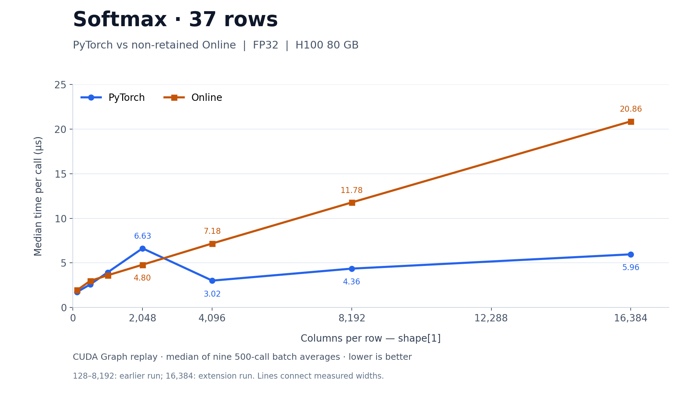
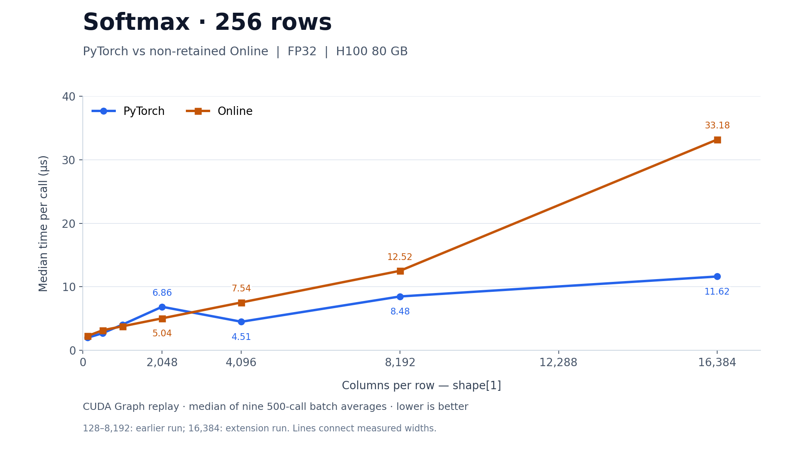
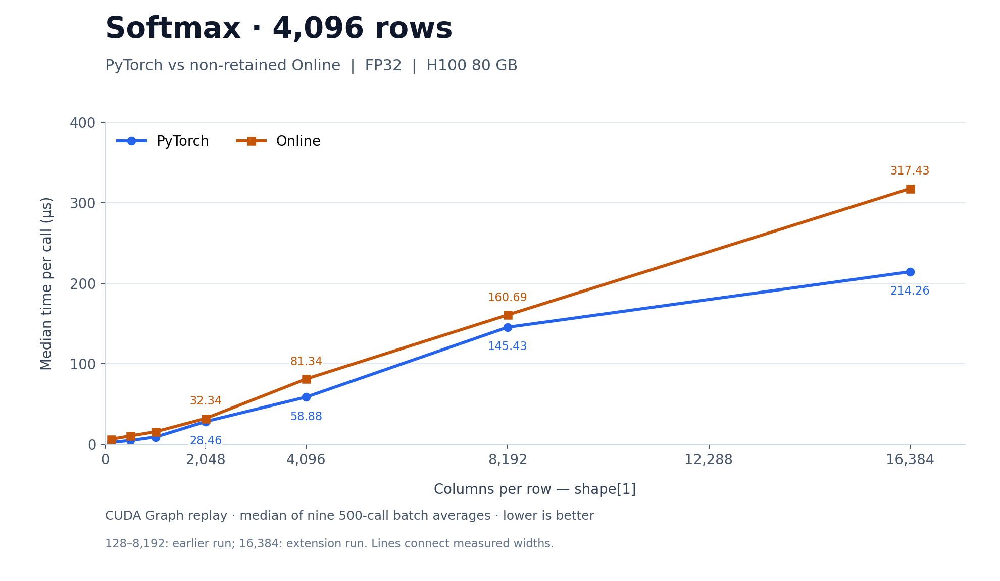
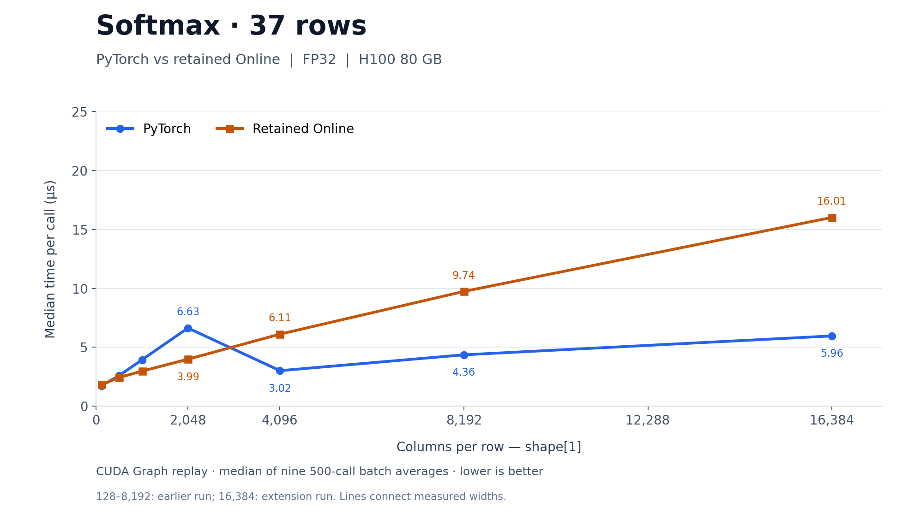
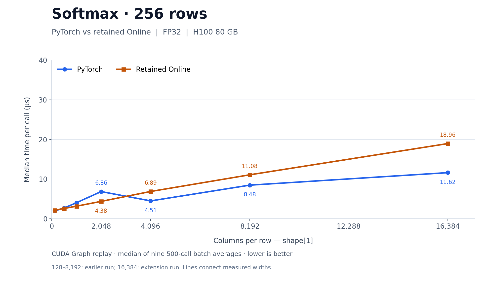
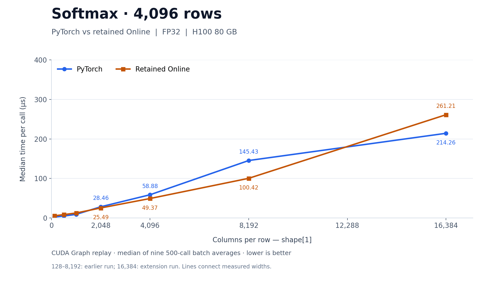

# 10 — PyTorch versus Online variants: runtime by row width

- **Scope:** rows 37/256/4096; `shape[1]` = 128/512/1024/2048/4096/8192/16384.
- **Variants:** each plot compares PyTorch's eager-selected softmax with one
  custom variant: non-retained `softmax_online<128>` in the first set, retained
  `softmax_online_registers<128, dims>` in the second set.
- **Timing:** CUDA Graph replay, median of nine 500-call batch averages, in µs/call.
  These are not ordinary eager Python-call latencies. Lower is better.
- **Axes:** linear width and runtime, with time starting at zero. Each row count
  has its own y-axis range (25/40/400 µs respectively), shared by both variant
  plots for that row count. Small-width points remain at their actual numeric
  positions; value labels begin at width2048 to avoid overlap. Lines only connect
  sampled widths. Linear scales replace the earlier logarithmic versions at the
  user's request.
- **Provenance:** widths 128–8192 are from the earlier run; 16384 is from the
  extension. Ratios within a shape compare variants from the same run. Same FP32
  synthetic fixture on H100 80GB HBM3; PyTorch 2.11.0+cu130.

## Non-retained Online — 37 rows



[Editable SVG](figures/softmax-pytorch-online-rows-37.svg)

## Non-retained Online — 256 rows



[Editable SVG](figures/softmax-pytorch-online-rows-256.svg)

## Non-retained Online — 4096 rows



[Editable SVG](figures/softmax-pytorch-online-rows-4096.svg)

## Retained Online — 37 rows



[Editable SVG](figures/softmax-pytorch-retained-rows-37.svg)

## Retained Online — 256 rows



[Editable SVG](figures/softmax-pytorch-retained-rows-256.svg)

## Retained Online — 4096 rows



[Editable SVG](figures/softmax-pytorch-retained-rows-4096.svg)

## Reproduce and interpret

- [Plot script](../../benchmarks/plot_softmax_comparison.py) validates all 42 input
  measurements and their experiment labels before generating PNG/SVG files.
  Run from the repository root in a Python environment with Matplotlib:

  ```sh
  python3 project_03_gpu_operator_library/benchmarks/plot_softmax_comparison.py
  python3 project_03_gpu_operator_library/benchmarks/plot_softmax_comparison.py --variant online_registers
  ```

- Requires the separately downloaded
  [combined summary](../../results/2026-10-31-softmax-128k/combined_summary.csv).
- [Full tables, names and measurement limits](09-results-and-kernel-inventory.md).
  Curves describe observed timings; they do not establish algorithmic causes or
  statistically significant differences. No GPU runs are performed by the script.
- [Section index](README.md).
